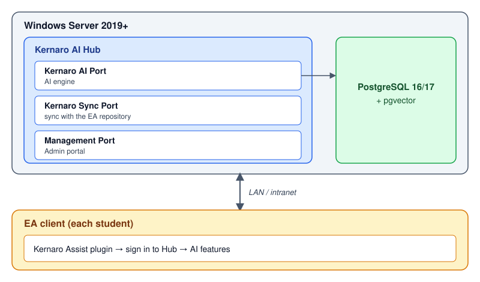

---
# 🧩 Versioning – systém dopĺňa automaticky
fm_version: "1.0.1"

# Dátum buildu – generuje skript
fm_build: "2026-10-18T12:24:05.538730+00:00"

# Poznámka k verzii – voliteľné
fm_version_comment: ""


# 🆔 IDENTITY --------------------------------------------------------

# ID generuje CLI / skript
id: "K000121_EN"

# Unikátne UUID – generuje skript
guid: "9773f99f-da26-407c-8822-9150d1eb027a"


# 🧭 CONTEXT ---------------------------------------------------------

# DAO / doména (knife, sdlc, q12, 7ds...) dopĺňa skript
dao: "knife"

# Názov zápisu – dopĺňa používateľ
title: "K000121 – Kernaro AI Hub: centralized AI access for teams"

# Krátky popis – dopĺňa používateľ (voliteľné)
description: "How to build Kernaro AI Hub as a central AI server for a team or class on Windows Server: installation order, pgvector, preparing the database, license, users and what the guides do not make obvious (HTTP vs HTTPS, ports, DNS). Students can also use AI from a browser without installing anything."


# 👥 AUTHORSHIP ------------------------------------------------------

# Hlavný autor – z globálneho configu
author: "Roman Kazicka"

# Zoznam autorov – generuje skript
authors:
  - "Roman Kazicka"


# 🗂 CLASSIFICATION ---------------------------------------------------

# Nadradená kategória – môže doplniť používateľ
category: ""

# Typ dokumentu (guide, case, tutorial...) – používateľ (voliteľné)
type: "guide"

# Priorita (low/medium/high) – voliteľné
priority: ""

# Tagy – odporúča sa 2–6 tagov.
# Typy tagov:
#   - rámce: knife, 7ds, sdlc, q12
#   - účel: tutorial, guide, pattern, case-study
#   - téma: git, backup, ai, communication
#   - úroveň: beginner, intermediate, advanced
tags: ["kernaro", "ea", "ai-hub", "licensing", "windows-server", "postgresql", "pgvector"]


# 🌍 LOCALIZATION -----------------------------------------------------

# Jazyk dokumentu – doplní skript podľa štruktúry
locale: "en"


# 🕒 LIFECYCLE --------------------------------------------------------

# Dátum vytvorenia – generuje skript
created: "2026-10-18 14:24"

# Dátum poslednej úpravy – dopĺňa človek
modified: "2026-10-18 20:00"

# Stav dokumentu – default "backlog"
status: "published"

# Viditeľnosť – default "public"
privacy: "public"


# ⚖ INTELLECTUAL PROPERTY -------------------------------------------

# Držiteľ práv k obsahu – dopĺňa skript
rights_holder_content: "Roman Kazicka"

# Systémový vlastník práv
rights_holder_system: "CAA / KNIFE / LetItGrow"

# Licencia
license: "CC-BY-NC-SA-4.0"

# Disclaimer
disclaimer: "Use at your own risk. Methods provided as-is; participation is voluntary and context-aware."

# Copyright
copyright: "© 2025 Roman Kazicka"


# 🔗 ORIGIN / PROVENANCE ---------------------------------------------

# Repozitár pôvodu
origin_repo: ""

# URL pôvodného repozitára
origin_repo_url: ""

# Commit pôvodu
origin_commit: ""

# Branch pôvodu
origin_branch: ""

# Systém pôvodu (CAA/KNIFE/STHDF…)
origin_system: "CAA"

# Pôvodný autor
origin_author: "Roman Kazicka"

# Importovaný zdroj
origin_imported_from: ""

# Dátum importu
origin_import_date: ""


# 🧱 RESERVED ---------------------------------------------------------

fm_reserved1: ""
fm_reserved2: ""
---

# K000121 – Kernaro AI Hub: centralized AI access for teams

> **KNIFE** – Knowledge In Friendly Examples
> **Series:** Systemic Thinking in IT & Digital Fabrication
> **Level:** Intermediate
> **Tags:** `kernaro` `ea` `ai-hub` `licensing` `windows-server` `postgresql` `pgvector`

**Version:** 1.2 | **Date:** 2026-10-18 | **Related:** [K000104 – SPARX AI Kernaro in SDLC](../K000104-SPARX_AI_KERNARO_IN_SDLC/index.md)

## 🎯 What it solves (purpose, goal)

How to build **Kernaro AI Hub** — one central AI server for a team or class — and what the guides do not make obvious. The findings below come from a real installation (Windows Server 2019, 2026-10-18, Management v1.1.0.1).

Kernaro AI is used in two ways that can be combined:

| Mode | For whom / where | What it needs |
|---|---|---|
| **Kernaro Assist** | The student works directly inside Sparx Enterprise Architect; AI helps create and update model elements in natural language | Assist installer, Hub address, an assigned seat |
| **Kernaro AI Hub – web** | The student uses AI in a **browser** via the Hub's central address — **no installation** on their own computer | Just the Hub URL and assigned permissions |

The Hub also acts as the **Assist license manager** (License Manager): you assign seats and monitor sessions. For Kernaro in an SDLC context see K000104.

## 🧩 How it solves it (principle)

AI and administration run on one server; clients (Assist in EA and a web browser) connect to it over the network.



Components, to be installed in this order:

| # | Component | Note |
|---|---|---|
| 1 | Windows Server 2019+ | admin rights |
| 2 | **PostgreSQL 16 or 17** | not 18 — Sparx specifies 16/17 |
| 3 | pgvector | built from source (Git + VS Build Tools) |
| 4 | EA GraphLink | **before** the Hub, shipped in the Hub ZIP |
| 5 | Kernaro AI Hub | `KernaroAI-Setup` |
| 6 | License file | issued for the server's Machine ID |
| 7 | Kernaro Assist | only on clients, separate installer |

> ℹ️ Installers are provided by Sparx Systems after approval (academic Workgroup license). Hub and GraphLink come in one ZIP, Assist in another. Ask for the **latest versions** — Hub and Assist versions should match.

## 🧪 How to use it (application)

### 1. PostgreSQL 17

Installer from postgresql.org (EDB), port `5432`, default locale, Stack Builder not needed. Write down the `postgres` user's password.

⚠️ **Watch the version:** the newest installer may be 18. The Hub requires 16/17, so download 17.

### 2. pgvector (build on Windows)

The build needs **Visual Studio Build Tools 2022** (workload *Desktop development with C++*; MSVC v143 x64/x86 and the Windows SDK are enough, about 7 GB) and Git.

> ⚠️ `cl` and `nmake` are **not in PATH** in a plain PowerShell. Open **x64 Native Tools Command Prompt for VS 2022** as administrator. Check: both `cl` and `nmake /?` must print a version.

```
set "PGROOT=C:\Program Files\PostgreSQL\17"
cd %TEMP%
git clone --branch v0.8.7 https://github.com/pgvector/pgvector.git
cd pgvector
nmake /F Makefile.win
nmake /F Makefile.win install
```

Find the current tag at github.com/pgvector/pgvector (here v0.8.7). **Do not enable the extension in the database by hand** — the Hub installer does it (see below).

### 3. EA GraphLink

The installer asks for a host and port. With the Hub on the same server keep `localhost` and `8090`. Check: `netstat -ano | findstr :8090` must show `LISTENING`.

### 4. Preparing the database

The Hub installer does **not** create the database and requires an **empty** one (errors *database does not exist* / *extension already exists in this database*):

```sql
CREATE DATABASE kernaro;
```

User: superuser (`postgres`), schema `kernaroschema`. If you enabled `CREATE EXTENSION vector` by mistake, drop the database and recreate it empty.

### 5. Kernaro AI Hub (installer)

Screens in order: license agreement → destination folder → *Run Schema* → PostgreSQL connection → *Service Configuration* → summary.

In *Service Configuration*:

| Field | Value |
|---|---|
| Host | the server's **DNS name**, e.g. `kernaro.example.org` (not `localhost`) |
| AI Port / Sync Port / Management Port | `8000` / `8001` / `8002` |
| Super admin | `admin` + strong password (min. 8 chars, upper, lower, digit, special) |

Before installing, check the ports are free:

```
netstat -ano | findstr ":8000 :8001 :8002"
```

Empty output = free.

**DNS:** if the server has no DNS record, create an A record (`kernaro` → server IP, TTL 300) and verify with `nslookup kernaro.example.org`.

### 6. First start and license

After installation the portal opens at `http://<host>:8002`:

1. The **Create Administrator Account** page — finish it **immediately**. Until the account exists, anyone who can reach port 8002 can create it.
2. Log in; **License Configuration** shows the server's **Machine ID**.
3. Send the Machine ID to Sparx (the contact from the academic license). They return a license **file** for Kernaro AI and EA GraphLink.
4. In the portal: *Upload license file → Activate License*.

### 7. User management

Two account types: **Admin** (full access) | **Regular** (restricted access).

1. `Configuration → User Management → Add User`
2. `User & Access Control → Assist Access → Assign Users to Kernaro Assist`
3. Set **Write Access** (Enabled = create/edit content; Disabled = read only)
4. Hub tracks seats: **Available / Assigned / Total**

Limited License shows seat counters; Unlimited License hides them; management works identically.

### 8. Session monitoring

- **Real-time:** `User & Access Control → Assist Active Sessions` — User, Machine, Last Used, IP Address, Status. Admin can revoke individual or all sessions.
- **Audit log:** `Assist Session History` — Sign-In, Sign-Out, Session Refresh, Revocation, Access Denied, Expiration.

## 💡 Tips and notes — what is not obvious

| Problem | Cause / solution |
|---|---|
| `cl`, `nmake` not found | You are in PowerShell. Use *x64 Native Tools Command Prompt for VS 2022* |
| `database "kernaro" does not exist` | The Hub does not create it. `CREATE DATABASE kernaro;` |
| `extension(s) already exist … 'vector'` | The database must be unused. Drop it, create an empty one, leave the extension to the installer |
| PostgreSQL 18 | The Hub requires 16/17. Uninstall, install 17 |
| `https://host:8002` → `SSL_ERROR_RX_RECORD_TOO_LONG` | The Hub on 8000–8002 speaks **HTTP only**. Do not let the browser upgrade to HTTPS |
| PostgreSQL listens on all interfaces | The Hub is local. Set `listen_addresses = 'localhost'` in `postgresql.conf` and restart the service |

### Port and protocol — who is responsible for HTTPS?

A port does not decide the protocol: `443` is just a convention. Whether a connection on a port is encrypted is decided by **the program listening on it**. The Hub listens on HTTP.

- **A certificate for the server name is not enough.** The program on the port has to present it: either the Hub (if it supports TLS natively — *open question for Sparx*), or a **reverse proxy** in front of the Hub (IIS, nginx, Caddy) that terminates TLS and forwards to `http://localhost:8002`.
- If 80/443 are already used by another service on the server (e.g. Pro Cloud Server, Prolaborate), the proxy has to run on another port (e.g. 8443).
- After enabling HTTPS, update the addresses in Assist clients and check that the Hub does not hand the original `http://` URLs to clients.
- The certificate renews (every 60–90 days); the service must be reloaded after renewal.

### Diagnostics: timeout, TLS error or firewall?

The browser error tells you where to look:

| Error | Meaning | Where to look |
|---|---|---|
| `ERR_CONNECTION_TIMED_OUT` / `nc` timeout | The connection was **never established** (nobody answers) | Firewall (Windows or network), not the certificate |
| `ERR_CONNECTION_REFUSED` | Nothing is listening on the port | Service not running or listening elsewhere |
| `ERR_CERT_*`, `SSL_ERROR_*` | The connection exists, encryption failed | Certificate, HTTP vs HTTPS |

**A certificate never causes a timeout.** If a site "stopped working" shortly after a certificate was issued, the timing is a coincidence — check the network first.

The procedure that settles it:

1. On the server confirm the service listens and which process holds the port: `netstat -ano | findstr ":443"` and `tasklist /fi "pid eq <PID>"`. A local connection (`Test-NetConnection localhost -Port 443`) succeeds even when the firewall blocks external traffic, so it proves nothing.
2. Try from outside from another network (mobile data, not Wi-Fi) and with `nc -vz -w 5 <ip> <port>`. If another port (e.g. RDP 3389) works and web ports do not, one specific port is being filtered.
3. Turn on dropped-connection logging in Windows Firewall and repeat the attempt:
   ```
   netsh advfirewall set allprofiles logging droppedconnections enable
   Select-String -Path "$env:SystemRoot\System32\LogFiles\Firewall\pfirewall.log" -Pattern "DROP.* 443 " | Select -Last 10
   ```
   - `DROP ... RECEIVE` lines with your source address = **Windows Firewall** on the server is blocking.
   - No lines = packets never reach the server; a firewall in front of it (campus, hosting) drops them.
4. Turn logging off afterwards: `netsh advfirewall set allprofiles logging droppedconnections disable`.

### Firewall after an OS reinstall / upgrade

Windows Firewall blocks everything inbound that has no rule. After an **OS upgrade or reinstall**, the rules for services (web applications, Pro Cloud Server etc.) can be lost although the services run and listen. Everything works from inside the server, but times out from outside.

- Check the network profile (`Get-NetConnectionProfile`) and program-bound rules (`Get-NetFirewallApplicationFilter | ...`). An empty result = no rules.
- Restore rules for ports that should be public:
  ```
  New-NetFirewallRule -DisplayName "Web HTTPS 443" -Direction Inbound -Protocol TCP -LocalPort 443 -Action Allow -Profile Any
  ```
- Add the Hub ports (8000–8002) separately and **restrict the source** (`-RemoteAddress`) as long as the Hub speaks plain HTTP.
- After every OS change, test all services **from outside**, not just locally.

### Certificate via win-acme (Let's Encrypt)

If you already run certificates with `win-acme` (`wacs`), just add the Hub's name to the host list.

- The `--host` list is **one certificate for all domains**. A wrong name (typo in the TLD) fails the whole run: `Authorization result: invalid`, no new certificate is issued, the old one stays.
- `selfhosting` validation goes over **HTTP on the server's port 80**. The DNS record must exist and port 80 must be reachable from outside (see the firewall above).
- The issued certificate is **not picked up by the Hub on its own** — the Hub (if it supports TLS) or a reverse proxy has to present it.
- The PFX password does **not belong in the script** in plain text. Store it encrypted for a specific account (`Get-Credential | Export-Clixml`, read it with `Import-Clixml`) and protect the file with permissions (`icacls`).
- A scheduled task that "runs idle" is often blocked by a `pause` in the script, the wrong account, or a missing *Run with highest privileges*.
- If the scheduler does not work, renewal must be done by hand — keep the expiry date in a calendar.

### Security

- Open ports 8000/8001 only to the target network (students, VPN), **8002 (Management) only to the administrator**.
- Without HTTPS passwords travel readable over the network. Solve HTTPS first before exposing outside the local network.
- Passwords (PostgreSQL, Hub admin, PFX) do not belong in scripts or documentation.

### Notes for academic deployment

- 65 students = license for 65 Assist seats (Limited License)
- Write Access recommended **enabled** — active AI interaction has educational value
- The Hub's web interface lowers the barrier: students need no installation, only a URL
- Verify before launch: LAN or VPN? → firewall and ports
- Session History = student activity log (pedagogical value)

## ✅ Value / Summary

One server instead of N AI installations, central license and access management, an overview of sessions and an audit trail; students can also use AI from a browser without installing anything. The costliest installation steps are pgvector and preparing an empty database — the notes above save hours of trial and error.

## Sources

[1] https://sparxsystems.com/kernaro/resources/kernaro-ai/kernaro-user-management-user-guide/

[2] https://sparxsystems.com/kernaro/resources/kernaro-ai/kernaro-installation-guide/

[3] https://sparxsystems.com/kernaro/kernaro-ai-hub/

[4] https://github.com/pgvector/pgvector (Windows section)

<!-- body:start -->

<!-- nav:knifes -->
> [⬅ KNIFES – Overview](../knifes_overview/KNIFE_Overview_Blog.md) • [List](../knifes_overview/KNIFE_Overview_List.md) • [Details](../knifes_overview/KNIFE_Overview_Details.md)
