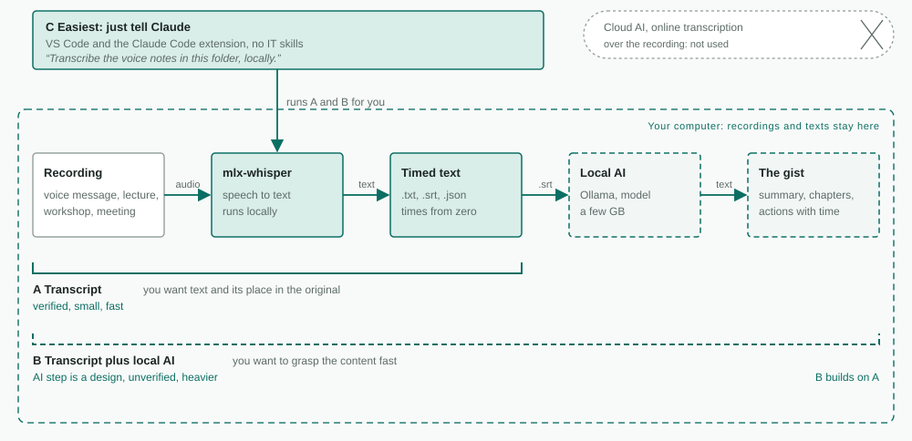
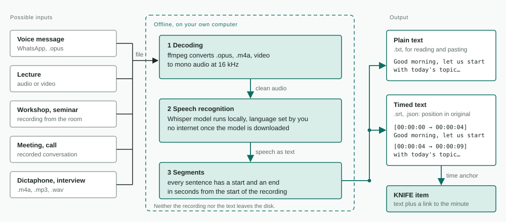
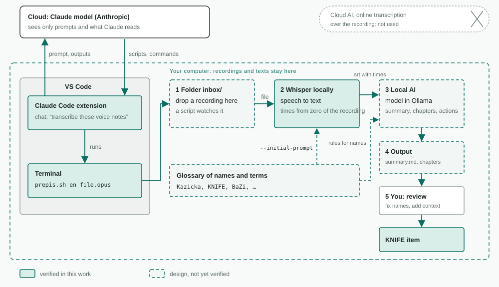

---
# 🧩 Versioning – systém dopĺňa automaticky
fm_version: "1.0.1"

# Dátum buildu – generuje skript
fm_build: "2026-11-15T10:22:03.820259+00:00"

# Poznámka k verzii – voliteľné
fm_version_comment: ""


# 🆔 IDENTITY --------------------------------------------------------

# ID generuje CLI / skript
id: "K000122"

# Unikátne UUID – generuje skript
guid: "5d826999-c2f4-47ba-943e-8dc6cb3d68b4"


# 🧭 CONTEXT ---------------------------------------------------------

# DAO / doména (knife, sdlc, q12, 7ds...) dopĺňa skript
dao: "knife"

# Názov zápisu – dopĺňa používateľ
title: "K000122 – Local audio transcription and AI on top, private and offline"

# Krátky popis – dopĺňa používateľ (voliteľné)
description: "Two use cases for recordings (voice message, lecture, workshop, meeting): A) transcript with timestamps via mlx-whisper, B) plus a local AI (Ollama) for summary, chapters and action items. Everything runs on your own computer."


# 👥 AUTHORSHIP ------------------------------------------------------

# Hlavný autor – z globálneho configu
author: "Roman Kazicka"

# Zoznam autorov – generuje skript
authors:
  - "Roman Kazicka"


# 🗂 CLASSIFICATION ---------------------------------------------------

# Nadradená kategória – môže doplniť používateľ
category: ""

# Typ dokumentu (guide, case, tutorial...) – používateľ (voliteľné)
type: "guide"

# Priorita (low/medium/high) – voliteľné
priority: ""

# Tagy – odporúča sa 2–6 tagov.
# Typy tagov:
#   - rámce: knife, 7ds, sdlc, q12
#   - účel: tutorial, guide, pattern, case-study
#   - téma: git, backup, ai, communication
#   - úroveň: beginner, intermediate, advanced
tags: ["transcription","whisper","ollama","local-ai","offline","privacy","audio","mac"]


# 🌍 LOCALIZATION -----------------------------------------------------

# Jazyk dokumentu – doplní skript podľa štruktúry
locale: "en"


# 🕒 LIFECYCLE --------------------------------------------------------

# Dátum vytvorenia – generuje skript
created: "2026-11-15 11:22"

# Dátum poslednej úpravy – dopĺňa človek
modified: "2026-11-15 11:22"

# Stav dokumentu – default "backlog"
status: "done"

# Viditeľnosť – default "public"
privacy: "public"


# ⚖ INTELLECTUAL PROPERTY -------------------------------------------

# Držiteľ práv k obsahu – dopĺňa skript
rights_holder_content: "Roman Kazicka"

# Systémový vlastník práv
rights_holder_system: "CAA / KNIFE / LetItGrow"

# Licencia
license: "CC-BY-NC-SA-4.0"

# Disclaimer
disclaimer: "Use at your own risk. Methods provided as-is; participation is voluntary and context-aware."

# Copyright
copyright: "© 2025 Roman Kazicka"


# 🔗 ORIGIN / PROVENANCE ---------------------------------------------

# Repozitár pôvodu
origin_repo: ""

# URL pôvodného repozitára
origin_repo_url: ""

# Commit pôvodu
origin_commit: ""

# Branch pôvodu
origin_branch: ""

# Systém pôvodu (CAA/KNIFE/STHDF…)
origin_system: "CAA"

# Pôvodný autor
origin_author: "Roman Kazicka"

# Importovaný zdroj
origin_imported_from: ""

# Dátum importu
origin_import_date: ""


# 🧱 RESERVED ---------------------------------------------------------

fm_reserved1: ""
fm_reserved2: ""
---

> **KNIFE** – Knowledge In Friendly Examples
> **Series:** Systemic Thinking in IT & Digital Fabrication
> **Level:** Beginner
> **Tags:** `transcription` `whisper` `ollama` `local-ai` `offline` `privacy` `audio` `mac`

# Local audio transcription and AI on top

## 🎯 What it solves (purpose, goal)

A colleague sends a ten-minute WhatsApp voice message and you need it as text. People with recorded lectures, workshops or meetings have the same problem. Online transcription services upload the recording to someone else's server. That is a poor fit for confidential conversations and personal recordings.

This KNIFE shows a workflow where neither the recording nor the text leaves your computer. The output is text plus **timestamps relative to the start of the recording**, so you can jump from the text back to the exact place in the original.

### Two use cases

By purpose there are two solutions. The second builds on the first.



| | A  Transcript | B  Transcript plus local AI |
|---|---|---|
| You want | text and its place in the original | to grasp the content fast |
| Output | `.txt`, `.srt`, `.json` | summary, chapters, actions with time |
| Tools | mlx-whisper | mlx-whisper and Ollama |
| Effort | a few minutes, about 1.5 GB | a few GB more, slower |
| Status | verified | AI step is a design, unverified |
| Fits | an occasional voice message | many or long recordings |

Details: **solution A** is under "How it solves it" and "How to use it", **solution B** under "Solution B" below.

## 🧩 How it solves it (principle)

### Solution A – transcript to text (verified)

The recording passes through three steps, all local:

1. **Decoding.** ffmpeg converts `.opus`, `.m4a` or video to mono audio.
2. **Speech recognition.** The Whisper model turns the audio into text. It needs no internet once the model is downloaded.
3. **Segments.** Every sentence gets a start and an end in seconds from zero of the recording.



Different kinds of recording (voice message, lecture, workshop, meeting, dictaphone) are only different inputs to the same flow.

## 🧪 How to use it (application)

The steps are verified on an Apple Silicon (arm64) Mac. You do not need Homebrew.

### Fastest: one script

Download the script `tools/prepis.sh` (it sits in this KNIFE's folder) and run it. On first run it installs everything it needs.

```bash
curl -O https://raw.githubusercontent.com/KNIFE-Framework/knifes_overview/main/content/docs/en/knifes/K000122-Local-Audio-Transcription/tools/prepis.sh
chmod +x prepis.sh
./prepis.sh en "lecture.m4a"          # English transcript
./prepis.sh sk "voice.opus"           # Slovak transcript
```

The result lands in a `prepis/` subfolder next to the recording. Optionally add `GLOSSARY="names, terms"` to help Whisper recognise names. To see what the script does, or to run it in parts, follow steps 1 to 4 below.

> ℹ️ The `curl` link starts working once this KNIFE is published on GitHub. Until then copy `prepis.sh` from the local repository.

### 1. Get the file

A WhatsApp voice message is an `.opus` file. In WhatsApp Desktop right-click and choose *Save as*. From a phone, send it to yourself by AirDrop or e-mail.

### 2. Install the tools in their own environment

```bash
python3 -m venv ~/whisper-env
~/whisper-env/bin/pip install mlx-whisper imageio-ffmpeg
```

`mlx-whisper` is Whisper optimised for Apple Silicon. The `imageio-ffmpeg` package brings ffmpeg without Homebrew. `mlx_whisper` looks for a program named `ffmpeg` on PATH, so link it:

```bash
ln -sf "$(~/whisper-env/bin/python -c 'import imageio_ffmpeg;print(imageio_ffmpeg.get_ffmpeg_exe())')" ~/whisper-env/bin/ffmpeg
```

The environment lives outside your projects, so it does not touch other Python installations.

### 3. Transcribe with timestamps

```bash
export PATH=~/whisper-env/bin:$PATH
mlx_whisper "voice.opus" \
  --model mlx-community/whisper-large-v3-turbo \
  --language en \
  --output-format all \
  --output-dir transcripts \
  --output-name voice_01
```

The first run downloads the model (about 1.5 GB). Later runs are offline. `--output-format all` writes every format at once:

| File | Use |
|---|---|
| `.txt` | plain text for reading and pasting |
| `.srt`, `.vtt` | subtitles: index, time `00:01:04,420 --> 00:01:07,240`, text |
| `.tsv` | table: start, end (in ms), text |
| `.json` | text, segments and times for further processing |

All times are **from the start of the file**. The mark `00:04:12` means 4 minutes 12 seconds after the recording began.

### 4. Check the result

In practice accuracy was around **90 %** on Slovak voice messages with weak audio. Errors are mostly diacritics, names and technical terms. Treat the transcript as a good draft to edit, not as final text.

## 💡 Tips and notes

- **File names with dots in the time.** WhatsApp files are named like `WhatsApp Audio 2026-11-15 at 09.51.17.opus`. When run over several files at once, the outputs overwrote each other into one file. Run the program one file at a time and set your own `--output-name`.
- **Language.** Set `--language` to the spoken language, for example `sk` or `cs`. Without it Whisper guesses, and on short recordings it can guess wrong.
- **Accuracy or speed.** `whisper-large-v3-turbo` is the fast compromise. `mlx-community/whisper-large-v3-mlx` is more accurate but slower.
- **No terminal.** The MacWhisper app does the same by drag and drop and also runs locally.
- **Privacy.** The internet is needed only once, to download the packages and the model. The transcription itself runs offline.
- **Other platforms.** The `mlx-whisper` route works only on Apple Silicon Macs. On Windows or Linux use `faster-whisper` or `whisper.cpp`; the flow is the same.

## 🤖 Solution B – transcript plus local AI (design)

Transcription is only the first step. The second step lets a **local AI** turn the text into a summary, chapters with time and a list of action items, with nothing leaving the computer.



**Who does what.** VS Code runs the Claude Code extension. The cloud Claude model helps write and run the script. The recording itself is then processed by local tools: Whisper for the transcript and a model in Ollama for the summary. Once the chain is set up, Claude is no longer needed.

**What is verified and what is not.** The transcription step (`prepis.sh` without a summary) is verified. The local AI summary (`SUMMARY=1`), folder watching and the name glossary are a design. The script is ready, but I did not test a local model. Slovak quality of small models in particular must be tried.

How to try it:

```bash
# 1. Install Ollama (https://ollama.com) and pull a model, a few GB
ollama pull qwen2.5:7b

# 2. Transcript and summary in one command
SUMMARY=1 GLOSSARY="Kazicka, KNIFE, BaZi" ./prepis.sh en "lecture.m4a"
```

The summary is saved as `prepis/<name>.summary.md`. The model receives the `.srt`, so chapters and action items carry a time from the start of the recording.

> ⚠️ **Privacy.** Claude Code uses a cloud model. It sees your prompts and everything Claude reads, including terminal output and files. If the recording is confidential, run the script yourself in a terminal and do not ask Claude to read the transcript. Then not even the text leaves your computer.

## ✅ Value / Summary

- A recording becomes text with the exact position in the original, without the cloud.
- One flow covers voice messages, lectures, workshops and meetings.
- Timestamps let a KNIFE link to a specific minute of the recording.
- The result needs a read-through, especially names and technical terms.
- Optionally a local AI turns the recording into a summary, chapters and action items with time (design).

## Sources

- OpenAI Whisper: <https://github.com/openai/whisper>
- MLX Whisper (Apple Silicon): <https://github.com/ml-explore/mlx-examples/tree/main/whisper>
- imageio-ffmpeg: <https://pypi.org/project/imageio-ffmpeg/>

<!-- body:start -->

<!-- nav:knifes -->
> [⬅ KNIFES – Overview](../knifes_overview/KNIFE_Overview_Blog.md) • [List](../knifes_overview/KNIFE_Overview_List.md) • [Details](../knifes_overview/KNIFE_Overview_Details.md)
