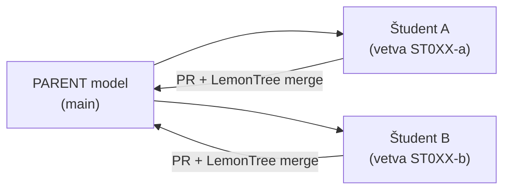

<!-- body:start -->

<!-- nav:knifes -->
> [⬅ KNIFES – Prehľad](../knifes_overview/KNIFE_Overview_Blog.md) • [Zoznam](../knifes_overview/KNIFE_Overview_List.md) • [Detaily](../knifes_overview/KNIFE_Overview_Details.md)
---
# KNIFE K000002 – Git workflow pre EA modely

<!-- fm-visible: start -->
> **GUID:** `6cf87ac0-1644-4134-8c67-8e61da2dca78`
> **Status:** `inprogress` · **Author:** Roman Kazička · **License:** CC-BY-NC-SA-4.0
<!-- fm-visible: end -->

> **KNIFE** – Knowledge In Friendly Examples
> **Séria:** Systemic Thinking in IT & Digital Fabrication
> **Tagy:** `git` `enterprise-architect` `lemontree` `tutorial`

> 🚧 **Rozpracované — pracujeme na obsahu.**
> Kompletný návod vzniká popri prednáške STHDF (október 2026).

## ⚡ Rýchly návod (Top)

*Čoskoro.* Zatiaľ sú funkčné kroky v README repozitára s modelom:
**[ea_model_sthdf_2026-2027](https://github.com/06-STH-Projects/ea_model_sthdf_2026-2027)**.

## 🎯 Čo tu bude

1. Stiahnutie `.qea` modelu z GitHubu a otvorenie v Enterprise Architect.
2. Vlastná vetva a zmena len vo vlastnom balíku.
3. Commit, push a Pull Request.
4. Trojcestný merge v LemonTree: *parent* (spoločný predok), *ours*, *theirs*.
5. Pravidlá, ktoré držia konflikty malé, a čo robiť, keď sa niečo pokazí.

*English version:* K000002 (EN).
