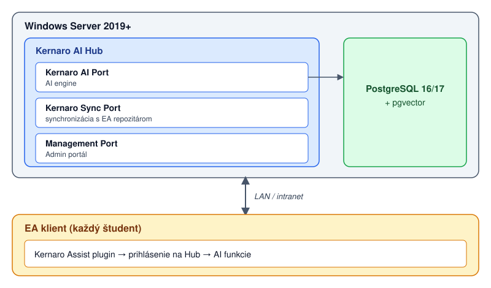

---
# 🧩 Versioning – systém dopĺňa automaticky
fm_version: "1.0.1"

# Dátum buildu – generuje skript
fm_build: "2026-10-18T12:24:05.506055+00:00"

# Poznámka k verzii – voliteľné
fm_version_comment: ""


# 🆔 IDENTITY --------------------------------------------------------

# ID generuje CLI / skript
id: "K000121"

# Unikátne UUID – generuje skript
guid: "0c6a9ff5-8fe2-40ec-8e2f-d32f9172455c"


# 🧭 CONTEXT ---------------------------------------------------------

# DAO / doména (knife, sdlc, q12, 7ds...) dopĺňa skript
dao: "knife"

# Názov zápisu – dopĺňa používateľ
title: "K000121 – Kernaro AI Hub: centralizovaný prístup k AI pre tím"

# Krátky popis – dopĺňa používateľ (voliteľné)
description: "Ako postaviť Kernaro AI Hub ako centrálny AI server pre tím alebo triedu na Windows Serveri: poradie inštalácie, pgvector, príprava databázy, licencia, používateľia a čo nie je zrejmé z návodov (HTTP vs HTTPS, porty, DNS). Študenti môžu AI používať aj z prehliadača bez inštalácie."


# 👥 AUTHORSHIP ------------------------------------------------------

# Hlavný autor – z globálneho configu
author: "Roman Kazicka"

# Zoznam autorov – generuje skript
authors:
  - "Roman Kazicka"


# 🗂 CLASSIFICATION ---------------------------------------------------

# Nadradená kategória – môže doplniť používateľ
category: ""

# Typ dokumentu (guide, case, tutorial...) – používateľ (voliteľné)
type: "guide"

# Priorita (low/medium/high) – voliteľné
priority: ""

# Tagy – odporúča sa 2–6 tagov.
# Typy tagov:
#   - rámce: knife, 7ds, sdlc, q12
#   - účel: tutorial, guide, pattern, case-study
#   - téma: git, backup, ai, communication
#   - úroveň: beginner, intermediate, advanced
tags: ["kernaro", "ea", "ai-hub", "licensing", "windows-server", "postgresql", "pgvector"]


# 🌍 LOCALIZATION -----------------------------------------------------

# Jazyk dokumentu – doplní skript podľa štruktúry
locale: "sk"


# 🕒 LIFECYCLE --------------------------------------------------------

# Dátum vytvorenia – generuje skript
created: "2026-10-18 14:24"

# Dátum poslednej úpravy – dopĺňa človek
modified: "2026-10-18 20:00"

# Stav dokumentu – default "backlog"
status: "published"

# Viditeľnosť – default "public"
privacy: "public"


# ⚖ INTELLECTUAL PROPERTY -------------------------------------------

# Držiteľ práv k obsahu – dopĺňa skript
rights_holder_content: "Roman Kazicka"

# Systémový vlastník práv
rights_holder_system: "CAA / KNIFE / LetItGrow"

# Licencia
license: "CC-BY-NC-SA-4.0"

# Disclaimer
disclaimer: "Use at your own risk. Methods provided as-is; participation is voluntary and context-aware."

# Copyright
copyright: "© 2025 Roman Kazicka"


# 🔗 ORIGIN / PROVENANCE ---------------------------------------------

# Repozitár pôvodu
origin_repo: ""

# URL pôvodného repozitára
origin_repo_url: ""

# Commit pôvodu
origin_commit: ""

# Branch pôvodu
origin_branch: ""

# Systém pôvodu (CAA/KNIFE/STHDF…)
origin_system: "CAA"

# Pôvodný autor
origin_author: "Roman Kazicka"

# Importovaný zdroj
origin_imported_from: ""

# Dátum importu
origin_import_date: ""


# 🧱 RESERVED ---------------------------------------------------------

fm_reserved1: ""
fm_reserved2: ""
---

# K000121 – Kernaro AI Hub: centralizovaný prístup k AI pre tím

> **KNIFE** – Knowledge In Friendly Examples
> **Séria:** Systemic Thinking in IT & Digital Fabrication
> **Úroveň:** Intermediate
> **Tagy:** `kernaro` `ea` `ai-hub` `licencovanie` `windows-server` `postgresql` `pgvector`

**Verzia:** 1.1 | **Dátum:** 2026-10-18 | **Súvisí s:** [K000104 – SPARX AI Kernaro v SDLC](../K000104-SPARX_AI_KERNARO_IN_SDLC/index.md)

## 🎯 Čo rieši (účel, cieľ)

Ako postaviť **Kernaro AI Hub** — jeden centrálny server s AI pre tím alebo triedu — a čo pri tom nie je zrejmé z návodov. Poznatky nižšie pochádzajú z reálnej inštalácie (Windows Server 2019, 2026-10-18, Management v1.1.0.1).

Kernaro AI sa používa dvoma spôsobmi, ktoré sa dajú kombinovať:

| Spôsob | Pre koho / kde | Čo potrebuje |
|---|---|---|
| **Kernaro Assist** | Študent pracuje priamo v Sparx Enterprise Architect; AI mu pomáha vytvárať a upravovať prvky modelu v prirodzenom jazyku | Inštalátor Assist, adresa Hubu, pridelený seat |
| **Kernaro AI Hub – web** | Študent používa AI v **prehliadači** cez centrálnu adresu Hubu — **bez inštalácie** na vlastnom počítači | Len URL Hubu a pridelené oprávnenia |

Hub tiež slúži ako **správca licencií Assist** (License Manager): prideľuješ seats a sleduješ relácie. Kontext použitia Kernaro v SDLC nájdeš v K000104.

## 🧩 Ako to rieši (princíp)

AI a správa bežia na jednom serveri; klienti (Assist v EA aj webový prehliadač) sa k nemu pripájajú po sieti.



Komponenty, ktoré treba nainštalovať v tomto poradí:

| # | Komponent | Poznámka |
|---|---|---|
| 1 | Windows Server 2019+ | admin práva |
| 2 | **PostgreSQL 16 alebo 17** | nie 18 — Sparx uvádza 16/17 |
| 3 | pgvector | build zo zdrojov (Git + VS Build Tools) |
| 4 | EA GraphLink | **pred** Hubom, v ZIP-e s Hubom |
| 5 | Kernaro AI Hub | `KernaroAI-Setup` |
| 6 | Licenčný súbor | podľa Machine ID servera |
| 7 | Kernaro Assist | až na klientoch, samostatný inštalátor |

> ℹ️ Inštalátory poskytuje Sparx Systems po schválení (akademická licencia Workgroup). Hub aj GraphLink sú v jednom ZIP-e, Assist v druhom. Pýtaj si **najnovšie verzie** — Hub a Assist majú mať zhodné verzie.

## 🧪 Ako to použiť (aplikácia)

### 1. PostgreSQL 17

Inštalátor z postgresql.org (EDB), port `5432`, predvolená locale, Stack Builder netreba. Zapíš si heslo používateľa `postgres`.

⚠️ **Pozor na verziu:** najnovší inštalátor môže byť 18. Hub vyžaduje 16/17, preto sťahuj 17.

### 2. pgvector (build na Windows)

Build potrebuje **Visual Studio Build Tools 2022** (workload *Desktop development with C++*; stačí MSVC v143 x64/x86 a Windows SDK, približne 7 GB) a Git.

> ⚠️ `cl` a `nmake` **nie sú v PATH** v obyčajnom PowerShelli. Otvor **x64 Native Tools Command Prompt for VS 2022** ako administrátor. Overenie: `cl` aj `nmake /?` musia vypísať verziu.

```
set "PGROOT=C:\Program Files\PostgreSQL\17"
cd %TEMP%
git clone --branch v0.8.7 https://github.com/pgvector/pgvector.git
cd pgvector
nmake /F Makefile.win
nmake /F Makefile.win install
```

Aktuálny tag nájdeš na github.com/pgvector/pgvector (tu v0.8.7). **Rozšírenie v databáze nezapínaj ručne** — urobí to inštalátor Hubu (viď nižšie).

### 3. EA GraphLink

Inštalátor sa pýta na host a port. Pri Hube na tom istom serveri nechaj `localhost` a `8090`. Overenie: `netstat -ano | findstr :8090` musí ukázať `LISTENING`.

### 4. Príprava databázy

Inštalátor Hubu databázu **nevytvára** a vyžaduje **prázdnu** databázu (hlásenie *database does not exist*, resp. *extension already exists in this database*):

```sql
CREATE DATABASE kernaro;
```

Používateľ: superuser (`postgres`), schéma `kernaroschema`. Ak si omylom zapol `CREATE EXTENSION vector`, databázu zahoď a vytvor znova prázdnu.

### 5. Kernaro AI Hub (inštalátor)

Obrazovky v poradí: licenčná zmluva → cieľový priečinok → *Run Schema* → pripojenie na PostgreSQL → *Service Configuration* → súhrn.

V *Service Configuration*:

| Pole | Hodnota |
|---|---|
| Host | **DNS názov servera**, napr. `kernaro.example.org` (nie `localhost`) |
| AI Port / Sync Port / Management Port | `8000` / `8001` / `8002` |
| Super admin | `admin` + silné heslo (min. 8 znakov, veľké, malé, číslo, špeciálny znak) |

Pred inštaláciou over, že porty sú voľné (pozor, `-ano` s pomlčkou, nie s lomkou):

```
netstat -ano | findstr ":8000 :8001 :8002"
```

Prázdny výstup = voľné.

**DNS:** ak server nemá DNS záznam, vytvor A záznam (`kernaro` → IP servera, TTL 300) a over `nslookup kernaro.example.org`.

### 6. Prvé spustenie a licencia

Po inštalácii sa otvorí portál `http://<host>:8002`:

1. Stránka **Create Administrator Account** — dokonči ju **hneď**. Kým účet nevznikne, môže ho vytvoriť ktokoľvek, kto dosiahne port 8002.
2. Prihlás sa; v **License Configuration** nájdeš **Machine ID** servera.
3. Pošli Machine ID Sparxu (kontakt z akademickej licencie). Vrátia licenčný **súbor** pre Kernaro AI aj EA GraphLink.
4. V portáli: *Upload license file → Activate License*.

### 7. Správa používateľov

Dva typy účtov: **Admin** (plný prístup) | **Regular** (obmedzený prístup).

1. `Configuration → User Management → Add User`
2. `User & Access Control → Assist Access → Assign Users to Kernaro Assist`
3. Nastav **Write Access** (Enabled = tvorba obsahu; Disabled = len čítanie)
4. Hub sleduje počty seats: **Available / Assigned / Total**

Limited License zobrazuje počítadlá seats; Unlimited License ich skrýva, správa funguje rovnako.

### 8. Monitoring sessions

- **Real-time:** `User & Access Control → Assist Active Sessions` — User, Machine, Last Used, IP Address, Status. Admin môže revokovať jednotlivú session alebo všetky naraz.
- **Audit log:** `Assist Session History` — Sign-In, Sign-Out, Session Refresh, Revocation, Access Denied, Expiration.

## 💡 Tipy a poznámky — čo nie je zrejmé

| Problém | Príčina / riešenie |
|---|---|
| `cl`, `nmake` neexistujú | Si v PowerShelli. Použi *x64 Native Tools Command Prompt for VS 2022* |
| `database "kernaro" does not exist` | Hub databázu nevytvára. `CREATE DATABASE kernaro;` |
| `extension(s) already exist … 'vector'` | Databáza nesmie byť „použitá“. Zahoď ju, vytvor prázdnu, rozšírenie nechaj na inštalátor |
| PostgreSQL 18 | Hub vyžaduje 16/17. Odinštaluj, nainštaluj 17 |
| Prázdny výsledok `netstat /ano` | Správne je `netstat -ano`; s lomkou vypíše len nápovedu |
| `https://host:8002` → `SSL_ERROR_RX_RECORD_TOO_LONG` | Hub na 8000–8002 hovorí **len HTTP**. Prehliadač neprepisuj na HTTPS |
| PostgreSQL počúva na všetkých rozhraniach | Hub je lokálny. V `postgresql.conf` nastav `listen_addresses = 'localhost'` a reštartuj službu |

### Port a protokol — kto je zodpovedný za HTTPS?

Port nerozhoduje o protokole: `443` je len konvencia. To, či spojenie na porte je šifrované, určuje **program, ktorý na ňom počúva**. Hub počúva po HTTP.

- **Certifikát pre názov servera nestačí.** Musí ho predložiť program na porte: buď Hub (ak natívne podporuje TLS — *otvorená otázka na Sparx*), alebo **reverzný proxy** pred Hubom (IIS, nginx, Caddy), ktorý TLS ukončí a prepošle na `http://localhost:8002`.
- Ak na serveri už 80/443 používa iná služba (napr. Pro Cloud Server, Prolaborate), proxy musí bežať na inom porte (napr. 8443).
- Po zapnutí HTTPS treba prepísať adresy v Assist klientoch a overiť, či Hub neposiela klientom pôvodné `http://` URL.
- Certifikát sa obnovuje (60–90 dní); po obnove treba službu reloadnúť.

### Bezpečnosť

- Porty 8000/8001 povoľ len pre cieľovú sieť (študenti, VPN), **8002 (Management) len pre administrátora**.
- Bez HTTPS idú heslá po sieti čitateľne. Mimo lokálnej siete HTTPS najprv vyrieš.
- Heslá (PostgreSQL, Hub admin, PFX) nepatria do skriptov ani do dokumentácie.

### Poznámky pre akademické nasadenie

- 65 študentov = licencia na 65 Assist seats (Limited License)
- Odporúčam Write Access **zapnúť** — aktívna AI interakcia má vzdelávaciu hodnotu
- Webové rozhranie Hubu znižuje bariéru: študent nepotrebuje inštaláciu, len URL
- Overiť pred spustením: LAN alebo VPN? → firewall a porty
- Session History = evidencia aktivity študentov (pedagogická hodnota)

## ✅ Hodnota / Zhrnutie

Jeden server namiesto N inštalácií AI, centrálna správa licencií a prístupu, prehľad relácií a auditná stopa; študenti môžu AI používať aj z prehliadača bez inštalácie. Najdrahšie kroky inštalácie sú pgvector a príprava prázdnej databázy — poznámky vyššie ušetria hodiny skúšania.

## Zdroje

[1] https://sparxsystems.com/kernaro/resources/kernaro-ai/kernaro-user-management-user-guide/

[2] https://sparxsystems.com/kernaro/resources/kernaro-ai/kernaro-installation-guide/

[3] https://sparxsystems.com/kernaro/kernaro-ai-hub/

[4] https://github.com/pgvector/pgvector (sekcia Windows)

<!-- body:start -->

<!-- nav:knifes -->
> [⬅ KNIFES – Prehľad](../knifes_overview/KNIFE_Overview_Blog.md) • [Zoznam](../knifes_overview/KNIFE_Overview_List.md) • [Detaily](../knifes_overview/KNIFE_Overview_Details.md)
