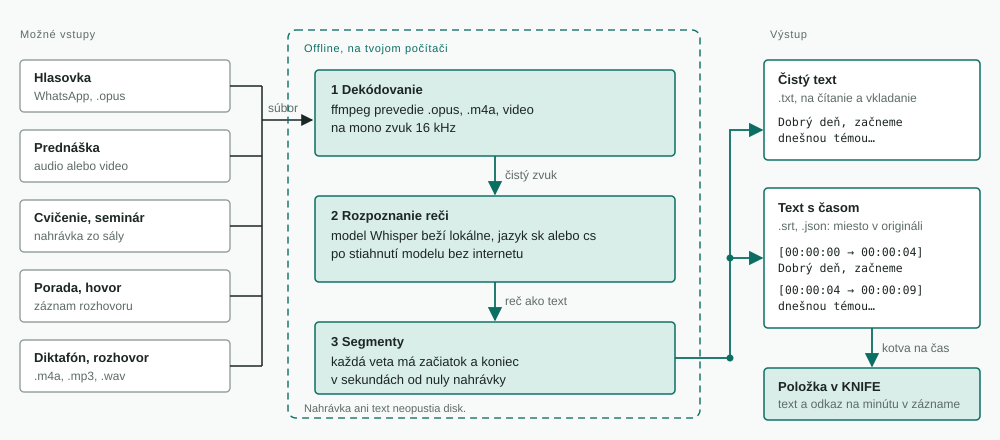
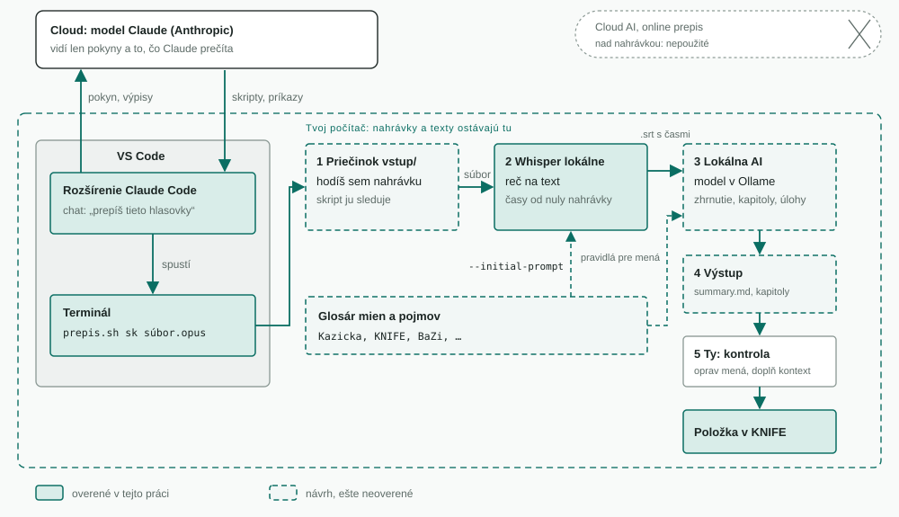

---
# 🧩 Versioning – systém dopĺňa automaticky
fm_version: "1.0.1"

# Dátum buildu – generuje skript
fm_build: "2026-11-15T10:22:03.790248+00:00"

# Poznámka k verzii – voliteľné
fm_version_comment: ""


# 🆔 IDENTITY --------------------------------------------------------

# ID generuje CLI / skript
id: "K000122"

# Unikátne UUID – generuje skript
guid: "138d3a83-6dbc-4dbc-ac9b-eed2d8491c5d"


# 🧭 CONTEXT ---------------------------------------------------------

# DAO / doména (knife, sdlc, q12, 7ds...) dopĺňa skript
dao: "knife"

# Názov zápisu – dopĺňa používateľ
title: "K000122 – Lokálny prepis zvuku na text s časovými značkami"

# Krátky popis – dopĺňa používateľ (voliteľné)
description: "Ako na vlastnom počítači, bez cloudu, previesť hlasovku, prednášku alebo záznam porady na text s časovými značkami počítanými od začiatku nahrávky. Postup pre Mac s Apple Silicon cez Whisper (mlx-whisper), bez Homebrew."


# 👥 AUTHORSHIP ------------------------------------------------------

# Hlavný autor – z globálneho configu
author: "Roman Kazicka"

# Zoznam autorov – generuje skript
authors:
  - "Roman Kazicka"


# 🗂 CLASSIFICATION ---------------------------------------------------

# Nadradená kategória – môže doplniť používateľ
category: ""

# Typ dokumentu (guide, case, tutorial...) – používateľ (voliteľné)
type: "guide"

# Priorita (low/medium/high) – voliteľné
priority: ""

# Tagy – odporúča sa 2–6 tagov.
# Typy tagov:
#   - rámce: knife, 7ds, sdlc, q12
#   - účel: tutorial, guide, pattern, case-study
#   - téma: git, backup, ai, communication
#   - úroveň: beginner, intermediate, advanced
tags: ["transcription","whisper","offline","privacy","audio","mac"]


# 🌍 LOCALIZATION -----------------------------------------------------

# Jazyk dokumentu – doplní skript podľa štruktúry
locale: "sk"


# 🕒 LIFECYCLE --------------------------------------------------------

# Dátum vytvorenia – generuje skript
created: "2026-11-15 11:22"

# Dátum poslednej úpravy – dopĺňa človek
modified: "2026-11-15 11:22"

# Stav dokumentu – default "backlog"
status: "done"

# Viditeľnosť – default "public"
privacy: "public"


# ⚖ INTELLECTUAL PROPERTY -------------------------------------------

# Držiteľ práv k obsahu – dopĺňa skript
rights_holder_content: "Roman Kazicka"

# Systémový vlastník práv
rights_holder_system: "CAA / KNIFE / LetItGrow"

# Licencia
license: "CC-BY-NC-SA-4.0"

# Disclaimer
disclaimer: "Use at your own risk. Methods provided as-is; participation is voluntary and context-aware."

# Copyright
copyright: "© 2025 Roman Kazicka"


# 🔗 ORIGIN / PROVENANCE ---------------------------------------------

# Repozitár pôvodu
origin_repo: ""

# URL pôvodného repozitára
origin_repo_url: ""

# Commit pôvodu
origin_commit: ""

# Branch pôvodu
origin_branch: ""

# Systém pôvodu (CAA/KNIFE/STHDF…)
origin_system: "CAA"

# Pôvodný autor
origin_author: "Roman Kazicka"

# Importovaný zdroj
origin_imported_from: ""

# Dátum importu
origin_import_date: ""


# 🧱 RESERVED ---------------------------------------------------------

fm_reserved1: ""
fm_reserved2: ""
---

> **KNIFE** – Knowledge In Friendly Examples
> **Séria:** Systemic Thinking in IT & Digital Fabrication
> **Úroveň:** Beginner
> **Tagy:** `transcription` `whisper` `offline` `privacy` `audio` `mac`

# Lokálny prepis zvuku na text s časovými značkami

## 🎯 Čo rieši (účel, cieľ)

Kolega pošle desaťminútovú hlasovku cez WhatsApp a ty ju potrebuješ ako text. Rovnaký problém majú ľudia s nahratými prednáškami, cvičeniami alebo poradami. Online prepisovacie služby nahrávku posielajú na cudzí server. To je zlé pri dôverných rozhovoroch a pri osobných nahrávkach.

Tento KNIFE ukazuje postup, pri ktorom nahrávka ani text neopustia tvoj počítač. Výstupom je text a k nemu **časové značky relatívne od začiatku nahrávky**. Z textu sa tak dá vrátiť na presné miesto v origináli.

## 🧩 Ako to rieši (princíp)

Nahrávka prejde tromi krokmi, všetky bežia lokálne:

1. **Dekódovanie.** ffmpeg prevedie `.opus`, `.m4a` alebo video na mono zvuk.
2. **Rozpoznanie reči.** Model Whisper zvuk prepíše na text. Po stiahnutí modelu nepotrebuje internet.
3. **Segmenty.** Každá veta dostane začiatok a koniec v sekundách od nuly nahrávky.



Rôzne druhy nahrávok (hlasovka, prednáška, cvičenie, porada, diktafón) sú len rôzne vstupy do toho istého toku.

## 🧪 Ako to použiť (aplikácia)

Postup je overený na Macu s Apple Silicon (arm64). Nainštalovaný Homebrew nepotrebuješ.

### Najrýchlejšie: jeden skript

Stiahni skript `tools/prepis.sh` (je v priečinku tohto KNIFE) a spusti ho. Pri prvom spustení si sám nainštaluje všetko, čo potrebuje.

```bash
curl -O https://raw.githubusercontent.com/KNIFE-Framework/knifes_overview/main/content/docs/sk/knifes/K000122-Local-Audio-Transcription/tools/prepis.sh
chmod +x prepis.sh
./prepis.sh sk "hlasovka.opus"        # slovenský prepis
./prepis.sh en "lecture.m4a"          # anglický prepis
```

Výsledok nájdeš v podpriečinku `prepis/` vedľa nahrávky. Voliteľne pridaj `GLOSSARY="mená, pojmy"` pre lepšie rozpoznanie mien. Ak chceš vedieť, čo skript robí, alebo ho chceš spustiť po častiach, sú nižšie kroky 1 až 4.

> ℹ️ Odkaz na `curl` začne fungovať po zverejnení tohto KNIFE na GitHube. Do tej doby skopíruj `prepis.sh` z lokálneho repozitára.

### 1. Získaj súbor

WhatsApp hlasovka je súbor `.opus`. Vo WhatsApp Desktop použi pravý klik a *Uložiť ako*. Z mobilu si ju pošli cez AirDrop alebo e-mail.

### 2. Nainštaluj nástroje do vlastného prostredia

```bash
python3 -m venv ~/whisper-env
~/whisper-env/bin/pip install mlx-whisper imageio-ffmpeg
```

`mlx-whisper` je Whisper optimalizovaný pre Apple Silicon. Balík `imageio-ffmpeg` prinesie ffmpeg bez Homebrew. `mlx_whisper` hľadá program s názvom `ffmpeg` v PATH, preto k nemu vytvor odkaz:

```bash
ln -sf "$(~/whisper-env/bin/python -c 'import imageio_ffmpeg;print(imageio_ffmpeg.get_ffmpeg_exe())')" ~/whisper-env/bin/ffmpeg
```

Prostredie je mimo tvojich projektov, takže nezasahuje do iných Python inštalácií.

### 3. Prepíš s časovými značkami

```bash
export PATH=~/whisper-env/bin:$PATH
mlx_whisper "hlasovka.opus" \
  --model mlx-community/whisper-large-v3-turbo \
  --language sk \
  --output-format all \
  --output-dir prepis \
  --output-name hlasovka_01
```

Prvé spustenie stiahne model (asi 1,5 GB). Ďalšie behy sú offline. `--output-format all` vytvorí všetky formáty naraz:

| Súbor | Na čo je |
|---|---|
| `.txt` | čistý text na čítanie a vkladanie |
| `.srt`, `.vtt` | titulky: číslo, čas `00:01:04,420 --> 00:01:07,240`, text |
| `.tsv` | tabuľka: začiatok, koniec (v ms), text |
| `.json` | text, segmenty a časy pre ďalšie spracovanie |

Všetky časy sú **od začiatku súboru**. Značka `00:04:12` znamená 4 minúty 12 sekúnd od štartu nahrávky.

### 4. Skontroluj výsledok

V praxi bola presnosť zhruba **90 %** na slovenských hlasovkách so slabším zvukom. Chyby sú hlavne v diakritike, v menách a v odborných termínoch. Prepis ber ako dobrý koncept na redakciu, nie ako finálny text.

## 💡 Tipy a poznámky

- **Mená súborov s bodkami v čase.** WhatsApp súbory majú názov ako `WhatsApp Audio 2026-11-15 at 09.51.17.opus`. Pri spustení nad viacerými súbormi naraz sa výstupy prepísali do jedného súboru. Spúšťaj program po jednom súbore a zadaj vlastný `--output-name`.
- **Jazyk.** Pre češtinu daj `--language cs`. Bez `--language` si Whisper jazyk odhadne a pri krátkych nahrávkach sa môže pomýliť.
- **Presnosť alebo rýchlosť.** `whisper-large-v3-turbo` je rýchly kompromis. Presnejší, ale pomalší je `mlx-community/whisper-large-v3-mlx`.
- **Bez terminálu.** Aplikácia MacWhisper robí to isté cez drag and drop a tiež beží lokálne.
- **Súkromie.** Internet treba len na jednorazové stiahnutie balíkov a modelu. Samotný prepis beží offline.
- **Iné platformy.** Postup s `mlx-whisper` platí len pre Mac s Apple Silicon. Na Windows alebo Linuxe použi `faster-whisper` alebo `whisper.cpp`, princíp toku zostáva rovnaký.

## 🤖 Plne automaticky s lokálnou AI (návrh)

Prepis je len prvý krok. Druhý krok je nechať **lokálnu AI** z textu urobiť zhrnutie, kapitoly s časom a zoznam úloh. Pritom nič neopustí počítač.



**Kto čo robí.** Vo VS Code beží rozšírenie Claude Code. Cloudový model Claude pomôže skript napísať a spustiť. Samotné spracovanie nahrávky potom robia lokálne nástroje: Whisper na prepis a model v Ollame na zhrnutie. Raz nastavený reťazec už Claude nepotrebuje.

**Čo je overené a čo nie.** Overený je krok prepisu (`prepis.sh` bez zhrnutia). Zhrnutie lokálnou AI (`SUMMARY=1`), sledovanie priečinka a glosár mien sú návrh. Skript je pripravený, ale lokálny model som netestoval. Najmä kvalita slovenčiny malých modelov sa musí vyskúšať.

Ako to skúsiť:

```bash
# 1. Nainštaluj Ollamu (https://ollama.com) a stiahni model, niekoľko GB
ollama pull qwen2.5:7b

# 2. Prepis a zhrnutie jedným príkazom
SUMMARY=1 GLOSSARY="Kazicka, KNIFE, BaZi" ./prepis.sh sk "hlasovka.opus"
```

Zhrnutie sa uloží ako `prepis/<nazov>.summary.md`. Model dostane `.srt`, takže kapitoly a úlohy majú čas od začiatku nahrávky.

> ⚠️ **Súkromie.** Claude Code používa cloudový model. Vidí pokyny a všetko, čo Claude prečíta, vrátane výpisov z terminálu a súborov. Ak je nahrávka dôverná, spusti skript sám v termináli a nenechaj Claude čítať prepis. Potom neopustí počítač ani text.

## ✅ Hodnota / Zhrnutie

- Z nahrávky vznikne text aj s presným miestom v origináli, bez cloudu.
- Jeden tok pokrýva hlasovky, prednášky, cvičenia aj porady.
- Časové značky umožňujú v KNIFE odkazovať na konkrétnu minútu záznamu.
- Výsledok treba po prečítaní opraviť, najmä mená a odborné pojmy.
- Voliteľne lokálna AI urobí zo záznamu zhrnutie, kapitoly a úlohy s časom (návrh).

## Zdroje

- OpenAI Whisper: <https://github.com/openai/whisper>
- MLX Whisper (Apple Silicon): <https://github.com/ml-explore/mlx-examples/tree/main/whisper>
- imageio-ffmpeg: <https://pypi.org/project/imageio-ffmpeg/>

<!-- body:start -->

<!-- nav:knifes -->
> [⬅ KNIFES – Prehľad](../knifes_overview/KNIFE_Overview_Blog.md) • [Zoznam](../knifes_overview/KNIFE_Overview_List.md) • [Detaily](../knifes_overview/KNIFE_Overview_Details.md)
